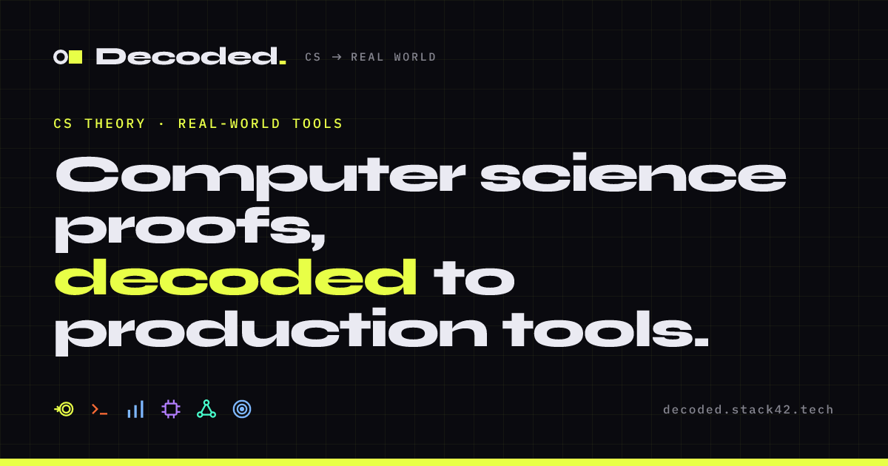

<div align="center">

<a href="https://decoded.stack42.tech"></a>

[](https://github.com/STACK-42/decoded/actions/workflows/ci.yml)
[](https://github.com/STACK-42/decoded/actions/workflows/deploy.yml)
[](https://decoded.stack42.tech)
[](https://react.dev)
[](https://vite.dev)
[](https://www.typescriptlang.org)
[](https://mdxjs.com)

**[decoded.stack42.tech](https://decoded.stack42.tech)**

</div>

Decoded is a free site of computer science courses that tie each piece of theory to the tools it powers: finite automata to regex engines, context-free grammars to parsers, sorting analysis to the library call you make every day.

## Why it exists

Most CS courses teach the abstract model and stop there. Theory of Computation is the usual example. DFAs, transition graphs and accepted languages can feel like they have nothing to do with real work, yet the same ideas run regex engines, compilers and a good part of security tooling. The theory isn't the problem. What's missing is a map from what you learn to what you can do with it.

Decoded tries to draw that map. Every lesson answers one question:

> How does this theory turn into skills, tools and technologies I'll actually use?

## Courses

| Course | Status | Lessons |
| --- | --- | --- |
| [Theory of Computation](https://decoded.stack42.tech/courses/theory-of-computation) | Available | 17, across Foundations, Finite Automata and Context-Free Languages |
| [Algorithm Design & Analysis](https://decoded.stack42.tech/courses/algorithm-design-and-analysis) | Available | 14, from Big-O through sorting, searching, graphs, greedy and DP |
| [Advanced Algorithms & Analysis](https://decoded.stack42.tech/courses/advanced-algorithms) | Available | 24, from recurrences and hashing through red-black trees, shortest paths and P vs NP |
| [Computational Mathematics](https://decoded.stack42.tech/courses/computational-mathematics) | Available | 31, across matrices, polynomials, number theory and cryptography, in MATLAB with Python and ML links, plus a project that cleans noise out of a voice recording |
| [Computer Organization](https://decoded.stack42.tech/courses/computer-organization) | Available | 10, a top-down tour of the CPU, buses, memory and storage |
| [Logic Design](https://decoded.stack42.tech/courses/logic-design) | Available | 23, from gates and K-maps to latches, flip-flops and a memory unit, with live circuits |
| [Microprocessors](https://decoded.stack42.tech/courses/microprocessors) | Available | 12, real 8086 assembly with a step-through simulator |
| [Computer Architecture](https://decoded.stack42.tech/courses/computer-architecture) | Available | 15, instruction sets, cache, virtual memory, I/O, pipelines and parallelism |
| [Operating Systems](https://decoded.stack42.tech/courses/operating-systems) | Available | 17, from system calls and processes through synchronization, CPU scheduling and virtual memory, with Linux and Java threads labs |
| [Discrete Mathematics](https://decoded.stack42.tech/courses/discrete-mathematics) | Available | 23, across logic, sets, proof, counting, graphs and probability, with interactive truth tables, relations and proofs |
| [Data Structures](https://decoded.stack42.tech/courses/data-structures) | Available | 16, from arrays and linked lists through hash maps, heaps, tries and union-find, in Python with Java and C++ |
| [Computer Networks](https://decoded.stack42.tech/courses/computer-networks) | Available | 13, from layers and packets through subnets, routing, TCP, congestion control, DNS and HTTPS |
| [Computer Graphics](https://decoded.stack42.tech/courses/computer-graphics) | Available | 20, from pixels, color depth and resolution through CRT and flat-panel displays to DDA and Bresenham line drawing, step by step |
| [Computer Literacy](https://decoded.stack42.tech/courses/computer-literacy) | Available | 3 |
| [The Exam Mind](https://decoded.stack42.tech/courses/the-exam-mind) | Available | 4 |
| Distributed Systems | Coming soon | |

Lessons mix reading with step-through visualizers, practicals and end-of-module quizzes. Progress is saved in your browser, and signing in with GitHub or Google is optional if you want it to follow you between devices.

## Running it locally

You need Node.js 18 or newer. [Bun](https://bun.sh) works too and is what CI uses.

```bash
npm install
npm run dev      # http://localhost:8080
```

| Command | What it does |
| --- | --- |
| `npm run dev` | Vite dev server on port 8080 |
| `npm run build` | Production build, plus social preview images and per-page HTML |
| `npm run preview` | Serve the production build |
| `npm run lint` | ESLint |
| `npm run test` | Vitest, one run |

[docs/development.md](docs/development.md) covers the directory layout and config files, and [docs/brand.md](docs/brand.md) covers the visual identity.

## How content works

Lessons are MDX files under `src/content/<course-slug>/`. [`src/content/registry.ts`](src/content/registry.ts) lists every course, module and lesson, and the pages look everything up there. To add a lesson, write the `.mdx` file, import it in the registry and add an entry to its module.

To add a whole course, follow [docs/building-a-course.md](docs/building-a-course.md), which includes a prompt you can give a coding agent.

> [!IMPORTANT]
> There is no `MDXProvider`. An MDX file that uses `Callout`, `PracticalApplication` or another custom component has to import it from `@/components/mdx/MdxComponents` itself.

## Deployment

Every push to `main` builds the site and publishes it to GitHub Pages at [decoded.stack42.tech](https://decoded.stack42.tech). The [CI workflow](.github/workflows/ci.yml) runs lint, typecheck, tests and a build on each push and pull request.

Sign-in and saved progress run on a Cloudflare Worker in [`worker/`](worker), which pushing doesn't deploy. Run `npm run migrate` (if there's a new migration) and then `npx wrangler deploy` from that folder, before pushing any site change that depends on it.
